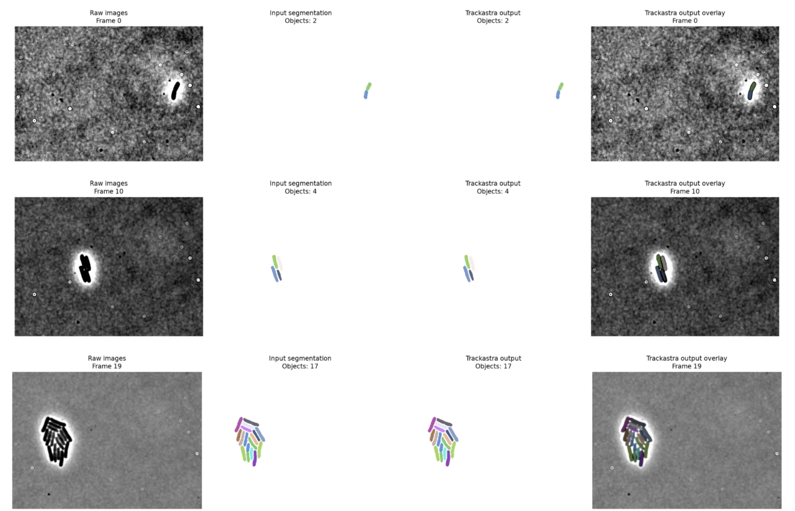

# Deep Learning for Single-Cell Analysis in Microfluidic Systems

**Sabancı University · Program for Undergraduate Research (PURE) · Summer 2026**

[**View the project website**](https://en-mah.github.io/Deep-Learning-for-Single-Cell-Analysis-in-Microfluidic-Systems/) · [Research report (PDF)](assets/research-report.pdf) · [Research poster (PDF)](assets/project-poster.pdf)

**Research intern:** Mahla Entezari  
**Supervisors:** Prof. Dr. Erchan Aptoula and Assoc. Prof. Dr. Meltem Elitas Hartmann  
**Internship period:** July 6 – August 20, 2026  
**Institution:** Sabancı University, Istanbul, Türkiye

## Overview

This project investigates **deep-learning methods for bacterial cell segmentation and tracking in time-lapse microscopy**, with the longer-term goal of supporting quantitative analysis of individual cells in microfluidic experiments. Reliable analysis is difficult when bacteria touch, divide, become densely packed, or develop elongated and filamentous morphologies under stress or antibiotic exposure.

The internship combined a literature and dataset review with hands-on benchmarking of existing tools. In particular, I evaluated **Trackastra** on bacterial time-lapse data, compared tracking from ground-truth and predicted segmentation masks, reproduced the segmentation component of the **OmniSegger** workflow with **Omnipose**, and explored **Bactrack** as a MATLAB-free tracking alternative.

**Main finding:** A strong tracking model cannot fully compensate for inaccurate segmentation: missed, split, or merged cell masks can substantially reduce downstream tracking performance.

## Project highlights

- Surveyed bacterial segmentation, tracking, and lineage-reconstruction methods and relevant annotated datasets.
- Deployed **Trackastra** and **Napari-Trackastra**, prepared bacterial sequences, and converted annotations into **Cell Tracking Challenge (CTC)** format.
- Compared **greedy** and **integer linear programming (ILP)** linking with ground-truth and Omnipose-generated masks.
- Reproduced **Omnipose** segmentation results on a published **141-frame** sequence and evaluated temporal-link and division-event consistency using **Bactrack**.
- Studied implications for single-cell growth, division, lineage reconstruction, and antibiotic-related morphological analysis.

## Experimental results

### 1. Trackastra tracking benchmark

**Dataset:** `trpL/150310-11`, 29 time-lapse frames. **Evaluation:** CTC-compatible tracking metrics. The same tracking framework was evaluated with different input masks.

| Segmentation masks | Linking | DET ↑ | TRA ↑ | HOTA ↑ | IDF1 ↑ | AOGM ↓ |
|---|---|---:|---:|---:|---:|---:|
| Ground truth | Greedy | 0.9945 | 0.9930 | 0.9898 | 0.9863 | 44.5 |
| **Ground truth** | **ILP** | **1.0000** | **0.9984** | **0.9975** | **0.9964** | **10.0** |
| Omnipose | Greedy | 0.9804 | 0.9671 | 0.9048 | 0.9047 | 208.0 |
| Omnipose | ILP | 0.9800 | 0.9668 | 0.9035 | 0.9049 | 210.0 |

With ILP linking, **TRA decreased from 0.9984 with ground-truth masks to 0.9668 with Omnipose masks**. These results are from this specific 29-frame evaluation; they do not establish performance across all bacterial datasets.



*Representative Trackastra visualizations from the internship progress report.*

### 2. OmniSegger / Omnipose reproduction

**Dataset:** OmniSegger proliferation sequence `xy5`, comprising **141 phase-contrast frames**. I ran the pretrained Omnipose `bact_phase_omni` model and compared its masks against the published segmentation outputs.

| Segmentation comparison metric | Result |
|---|---:|
| Mean matched IoU | **0.9824** |
| Precision | 0.9912 |
| Recall | 0.9804 |
| F1-score | **0.9825** |
| Mean absolute cell-count error | 0.206 cells/frame |

For a MATLAB-free tracking experiment, I used **Bactrack** with both the published masks and locally generated Omnipose masks. Comparing matched links between these two runs gave:

| Output agreement metric | F1-score |
|---|---:|
| Temporal tracking links | **0.9967** |
| Cell-division events | **0.9613** |

**Interpretation:** The Bactrack F1 values measure **agreement between two pipeline outputs**, not independently validated tracking accuracy against manually curated ground truth. The complete OmniSegger MATLAB/SuperSegger pipeline was not reproduced.

## Research workflow

```text
Time-lapse microscopy images
             ↓
Instance segmentation (Omnipose / reference masks)
             ↓
Cell detections and masks
             ↓
Cell tracking (Trackastra or Bactrack)
             ↓
Temporal associations and division links
             ↓
Quantitative evaluation and lineage analysis
```

The work reviewed methods including **Cellpose, Omnipose, STrack, FAST, Trackastra, DeLTA 2.0, DiSTNet2D, Cell-TRACTR,** and **OmniSegger**, with attention to biological assumptions, data availability, and limitations.

## Research materials

- [**Project website**](https://en-mah.github.io/Deep-Learning-for-Single-Cell-Analysis-in-Microfluidic-Systems/) — visual overview, methods, results, and documentation.
- [**Individual research report**](assets/research-report.pdf) — literature review, datasets, benchmarks, discussion, and references.
- [**Collaborative research poster**](assets/project-poster.pdf) — broader project context, including the collaborative CiproSeg work.

**Scope note:** The tracking benchmarks and workflow reproduction above are documented in Mahla Entezari's individual report. The poster covers a wider collaborative project, including CiproSeg segmentation and biological morphology measurements; those contributions should not be interpreted as solely my individual work.

## Repository structure

```text
.
├── index.html                 # Research website content
├── styles.css                 # Responsive website styling
├── .nojekyll                  # GitHub Pages configuration
├── README.md                  # Project documentation
└── assets/
    ├── favicon.svg
    ├── microscopy-raw.webp
    ├── microscopy-masks.webp
    ├── microscopy-tracked.webp
    ├── tracking-comparison.webp
    ├── research-report.pdf
    └── project-poster.pdf
```

This repository currently hosts the **research project website and supporting documents**, rather than a standalone release of the benchmarking scripts or trained models. The site is built with **HTML and CSS** and requires no build step or JavaScript dependencies.

### Run the website locally

Clone the repository:

```bash
git clone https://github.com/En-Mah/Deep-Learning-for-Single-Cell-Analysis-in-Microfluidic-Systems.git
cd Deep-Learning-for-Single-Cell-Analysis-in-Microfluidic-Systems
```

Open `index.html` in your browser. Alternatively, run a local server:

```bash
python3 -m http.server 8000
```

Then visit `http://localhost:8000`.

### Publish with GitHub Pages

In **Settings → Pages**, choose **Deploy from a branch**, select `main` and `/ (root)`, and save. The expected project URL is:

**https://en-mah.github.io/Deep-Learning-for-Single-Cell-Analysis-in-Microfluidic-Systems/**

## Limitations and next steps

The experiments represent specific bacterial time-lapse sequences rather than a comprehensive cross-dataset benchmark. Future work could include testing more species and experimental conditions, characterizing segmentation error propagation, improving lineage consistency, and validating tracking and morphological measurements in longer microfluidic time-lapse experiments.

## Acknowledgments

I am grateful to **Prof. Dr. Erchan Aptoula** and **Assoc. Prof. Dr. Meltem Elitas Hartmann** for supervising this work, and to **Sabancı University's PURE program** for the research opportunity. The accompanying collaborative poster also credits **Elif Rana Kinik**.

The tools and datasets discussed remain the work of their respective authors and maintainers. See the [research report](assets/research-report.pdf) for the scientific references.

---

*Project completed during the Sabancı University PURE 2026 summer research program.*
