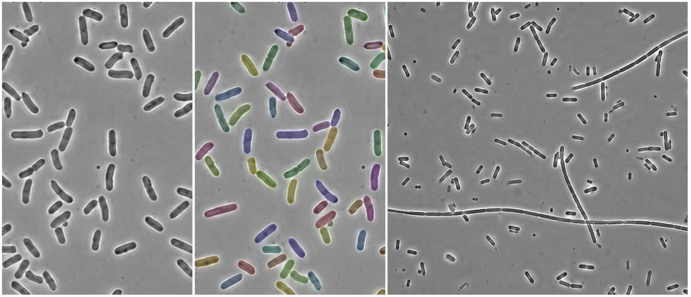
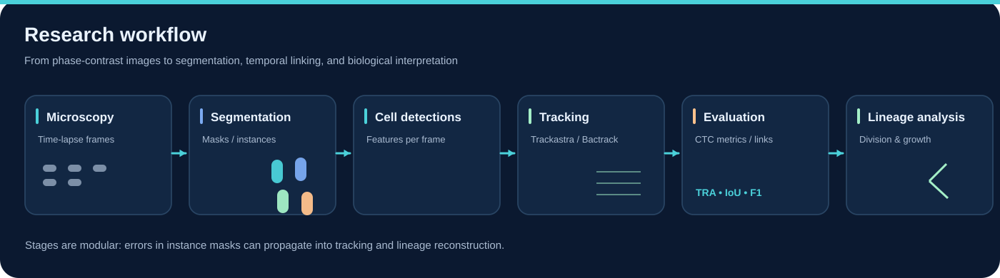
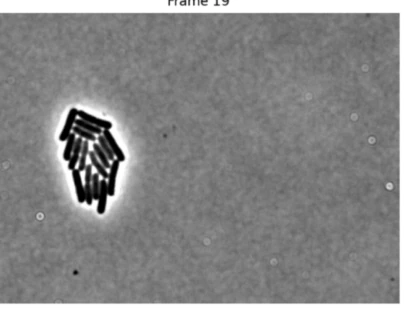
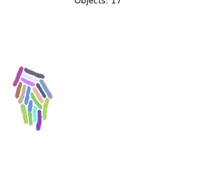
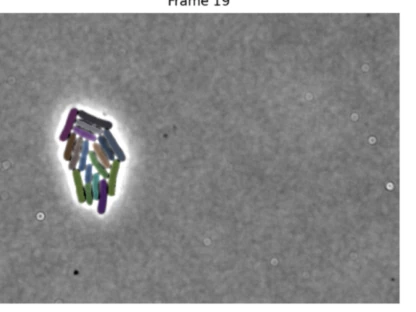
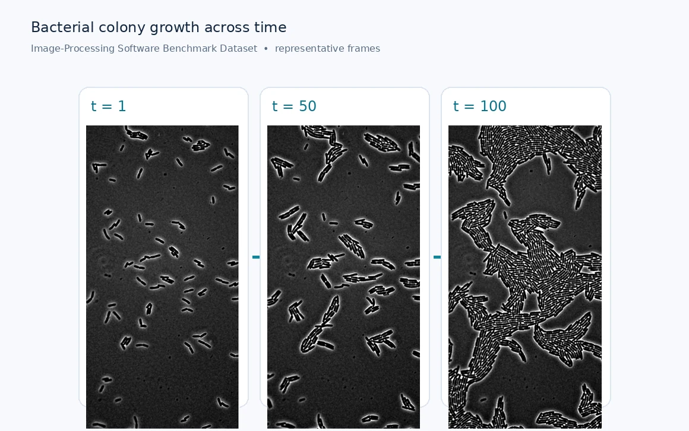
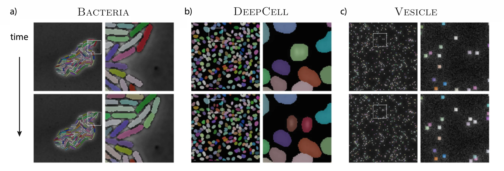
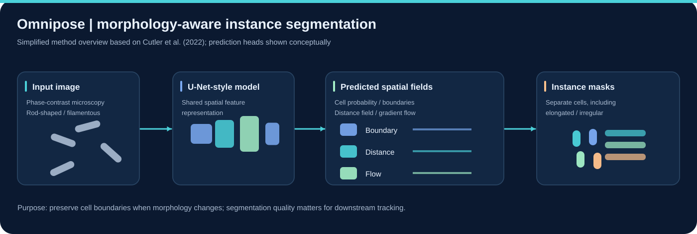
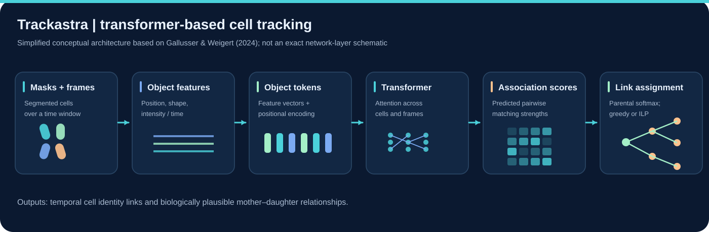
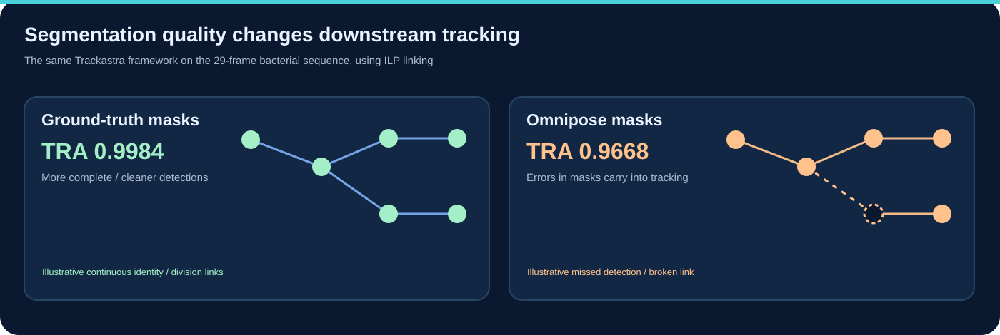

# Deep Learning for Single-Cell Analysis in Microfluidic Systems

**Sabancı University · Program for Undergraduate Research (PURE) · Summer 2026**

**[🌐 Project website](https://en-mah.github.io/Deep-Learning-for-Single-Cell-Analysis-in-Microfluidic-Systems/)** · [Research report (PDF)](assets/research-report.pdf) · [Research poster (PDF)](assets/project-poster.pdf)

**Research intern:** Mahla Entezari  
**Supervisors:** Prof. Dr. Erchan Aptoula and Assoc. Prof. Dr. Meltem Elitas Hartmann  
**Internship:** July 6 – August 20, 2026 · **Institution:** Sabancı University, Istanbul, Türkiye

## Overview

This research investigates **deep-learning methods for bacterial instance segmentation and cell tracking in time-lapse microscopy**. The broader motivation is to enable reliable single-cell measurements of bacterial growth, division, and morphological responses, including in future microfluidic experiments.

The internship combined a **literature and dataset survey** with practical experiments on **Trackastra, Omnipose, OmniSegger-related data, and Bactrack**. A central question was how errors in predicted cell masks affect downstream tracking and lineage reconstruction.



*Figure 1 — Examples of bacterial cells with different morphologies, from the [individual research report](assets/research-report.pdf), Figure 1. Touching and filamentous cells are particularly challenging for segmentation and tracking.*

### Research questions

- How do current segmentation methods cope with touching, elongated, and irregularly shaped bacteria?
- How do tracking methods associate cells between frames and account for mother–daughter divisions?
- Which public datasets provide masks, temporal links, or lineage annotations suitable for benchmarking?
- How does replacing ground-truth segmentation with predicted masks change tracking performance?

## Research workflow and visual examples



*Figure 2 — Original schematic of the modular research workflow. Tracking results depend on the masks produced upstream.*

### Example: microscopy → masks → tracked cells

| Raw phase-contrast frame | Input instance masks | Tracked-cell overlay |
|:--:|:--:|:--:|
|  |  |  |

*Figure 3 — Selected outputs from the Trackastra experiments. These images illustrate the progression from microscopy to segmented objects and tracked cell identities; see the [full report](assets/research-report.pdf) for the evaluation protocol.*

## Datasets and imaging conditions

The dataset review considered bacterial species, microscopy modality, temporal resolution, available masks, division links, and suitability for evaluating different stages of a pipeline.

### Colony growth changes the difficulty of tracking



*Figure 4 — Frames from the **Image-Processing Software Benchmark Dataset** at time points 1, 50, and 100, as shown in the [research report](assets/research-report.pdf), Figure 5. The dataset is described in [Ahmadi et al.'s benchmarking repository](https://github.com/ingallslab/ImageProcessing-Benchmarking). Increasing cell density makes reliable instance separation and association harder.*

### Datasets considered in the Trackastra literature



*Figure 5 — Examples of **BACTERIA**, **DeepCell**, and **VESICLE**, reproduced from the literature comparison in the [research report](assets/research-report.pdf), Figure 6; originating from [Gallusser & Weigert, Trackastra (2024)](https://arxiv.org/abs/2405.15700). These are **different training/evaluation domains**, not three datasets benchmarked in my own PURE experiments.*

| Dataset or source | What it provided or motivated | Role in this project |
|---|---|---|
| `trpL/150310-11` bacterial sequence | 29 time-lapse frames and tracking annotations converted into CTC format | **Trackastra experiment:** compare ground-truth and Omnipose masks, greedy and ILP linking |
| OmniSegger proliferation `xy5` | 141 phase-contrast frames and published instance masks | **Reproduction experiment:** Omnipose mask comparison, then Bactrack output agreement |
| Image-Processing Software Benchmark Dataset | Reference masks, trajectories, parent links, and lineage information | Literature/dataset evaluation and visualization |
| TrackRefiner, STrack, FAST and other public collections | Varied organisms, morphology, cell density, and tracking annotations | Dataset survey and assessment of future benchmarks |

The hands-on results below apply to the **specific 29-frame and 141-frame sequences** listed here; the other datasets are included as part of the review, not as claims of additional experiments.

## Methods and model architectures

### 1. Omnipose: instance segmentation

Omnipose adapts flow-based segmentation for challenging cell morphologies. Its predictions include spatial information about boundaries, distance, and flow, which is used to reconstruct separate instances even when bacterial cells are long or irregular.



*Figure 6 — Original **simplified conceptual diagram**, informed by [Cutler et al., “Omnipose” (2022)](https://doi.org/10.1038/s41592-022-01639-4). It is not an exact layer-by-layer reproduction of the published architecture.*

**Related methods reviewed:** Cellpose, MiSiC, DeLTA 2.0, and other approaches for bacterial and general cellular instance segmentation.

### 2. Trackastra: transformer-based temporal association

Trackastra represents segmented cells as tokens containing object-level features, uses a transformer to predict associations across a temporal window, and generates cell tracks using linking strategies such as greedy optimization or integer linear programming (ILP). It is designed to account for cell division.



*Figure 7 — Original **simplified conceptual diagram** based on [Gallusser & Weigert, “Trackastra: Transformer-based cell tracking for live-cell microscopy” (2024)](https://arxiv.org/abs/2405.15700). The figure summarizes the method; it is not a verbatim architecture drawing.*

**Other tracking/pipeline approaches reviewed:** STrack, FAST, graph-neural-network tracking, DeLTA 2.0, DiSTNet2D, Cell-TRACTR, and OmniSegger. They differ in their use of object features, temporal context, division constraints, and their dependence on input segmentation.

## Experimental results

### Experiment A — Trackastra benchmark

**Sequence:** `trpL/150310-11` · **Length:** 29 frames · **Evaluation:** CTC-compatible metrics.

I deployed Trackastra and Napari-Trackastra, prepared the sequence, converted tracking annotations into CTC format, and compared greedy versus ILP linking with ground-truth and Omnipose-generated masks.

| Input masks | Linking | DET ↑ | TRA ↑ | HOTA ↑ | IDF1 ↑ | AOGM ↓ |
|---|---|---:|---:|---:|---:|---:|
| Ground truth | Greedy | 0.9945 | 0.9930 | 0.9898 | 0.9863 | 44.5 |
| **Ground truth** | **ILP** | **1.0000** | **0.9984** | **0.9975** | **0.9964** | **10.0** |
| Omnipose | Greedy | 0.9804 | 0.9671 | 0.9048 | 0.9047 | 208.0 |
| Omnipose | ILP | 0.9800 | 0.9668 | 0.9035 | 0.9049 | 210.0 |



*Figure 8 — **Experimental TRA scores** for GT/ILP and Omnipose/ILP, accompanied by an **illustrative (not observed frame-by-frame) lineage schematic**. The diagrams do not represent exact reconstructed tracks.*


*Figure 9 — Actual Trackastra visualization panels from the internship progress report. In the 29-frame test, ILP reached **TRA = 0.9984** with ground-truth masks; when supplied with Omnipose masks, ILP reached **TRA = 0.9668**.*

**Key observation:** The tracking model was unchanged, but the segmentation input was not. The decrease in tracking performance demonstrates the importance of reliable upstream cell masks for this evaluation sequence.

### Experiment B — OmniSegger segmentation reproduction and Bactrack comparison

**Sequence:** OmniSegger proliferation dataset `xy5` · **Length:** 141 phase-contrast images.

I ran the pretrained `bact_phase_omni` Omnipose model on all 141 frames and compared its predicted masks with the published OmniSegger segmentation outputs.

| Segmentation comparison | Value |
|---|---:|
| Mean matched IoU | **0.9824** |
| Precision | 0.9912 |
| Recall | 0.9804 |
| F1-score | **0.9825** |
| Mean absolute cell-count error | 0.206 cells/frame |

Because the MATLAB/SuperSegger tracking component could not be run on the project server, **Bactrack** was evaluated as a MATLAB-free alternative. Published masks produced 4,818 temporal links and locally generated masks produced 4,816 links. Agreement between these two tracking outputs was:

| Output agreement | Precision | Recall | F1 |
|---|---:|---:|---:|
| Temporal links | 0.9987 | 0.9946 | **0.9967** |
| Division events | 0.9667 | 0.9560 | **0.9613** |

**Interpretation:** These Bactrack scores measure **agreement between two outputs**, not independently validated accuracy against manual tracking ground truth. The full OmniSegger MATLAB/SuperSegger pipeline was **not** reproduced.

## Limitations and research directions

The experiments cover selected publicly available sequences, not a comprehensive cross-dataset benchmark. Potential next steps include testing more bacterial species and imaging conditions, analyzing the types of mask errors that damage associations, evaluating lineage continuity over longer movies, and adapting validated methods to microfluidic time-lapse experiments.

## Research materials and project scope

- **[Project website](https://en-mah.github.io/Deep-Learning-for-Single-Cell-Analysis-in-Microfluidic-Systems/)** — visual research presentation hosted with GitHub Pages.
- **[Individual research report](assets/research-report.pdf)** — dataset and literature review, experimental protocol, results, and references.
- **[Collaborative project poster](assets/project-poster.pdf)** — broader project context, including CiproSeg and bacterial morphology analysis.

**Attribution and scope:** The Trackastra benchmarking, Omnipose reproduction, and Bactrack comparison described here are documented in Mahla Entezari's individual report. The collaborative poster also discusses **CiproSeg U-Net development and biological measurements**; these are not presented here as solely my individual work. Images originating from published datasets or papers remain attributable to their original authors; original schematic figures in this README are explicitly labeled.

## Repository structure

```text
.
├── index.html
├── styles.css
├── .nojekyll
├── README.md
└── assets/
    ├── bacterial-morphologies.webp
    ├── colony-growth-timelapse.webp
    ├── trackastra-dataset-examples.webp
    ├── research-workflow.svg
    ├── omnipose-concept.svg
    ├── trackastra-architecture.svg
    ├── segmentation-tracking-effect.svg
    ├── microscopy-raw.webp
    ├── microscopy-masks.webp
    ├── microscopy-tracked.webp
    ├── tracking-comparison.webp
    ├── research-report.pdf
    ├── project-poster.pdf
    └── favicon.svg
```

The repository hosts the **research website and documentation**; it is not a public release of training code, trained model weights, or benchmarking scripts.

### View locally

```bash
git clone https://github.com/En-Mah/Deep-Learning-for-Single-Cell-Analysis-in-Microfluidic-Systems.git
cd Deep-Learning-for-Single-Cell-Analysis-in-Microfluidic-Systems
python3 -m http.server 8000
```

Open <http://localhost:8000> in your browser. To publish from GitHub, go to **Settings → Pages**, select **Deploy from a branch → `main` → `/ (root)`**, and save.

## Acknowledgments

I thank **Prof. Dr. Erchan Aptoula** and **Assoc. Prof. Dr. Meltem Elitas Hartmann** for their supervision and the **Sabancı University PURE program** for the research opportunity. The collaborative poster also acknowledges **Elif Rana Kinik**. All third-party tools and research datasets belong to their respective authors and maintainers; full scientific references are provided in the [research report](assets/research-report.pdf).

---

*Completed during the Sabancı University PURE Summer 2026 program.*
